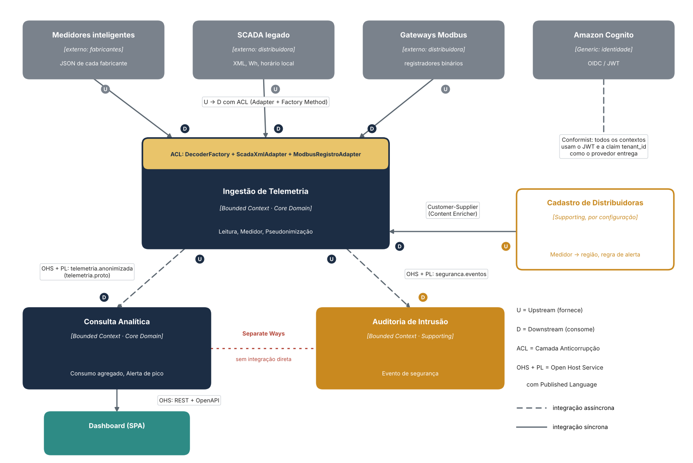

# Projeto Architectural Kata: Gird the Grid

> **Disciplina:** Arquitetura de Software | **Período:** 6º Período — Engenharia de Software
> **Turma:** Quarta-feira | **Sprint / Entrega:** Sprint 4 — Final do Projeto por Equipes

## Identificação da Equipe

| Nome do Integrante | Função na Sprint 4 (Liderança / Pesquisador / Executor) | GitHub |
|---|---|---|
| Wilton Ferreira | Líder & Arquiteto Principal | `@TheWilton` |
| Caio Carbornar | Pesquisador & Modelagem DDD · Pesquisador & Engenheiro de Resiliência & Integração | `@Caio-Carbornar` |
| Daniel Ulson | Executor & Especialista em IA-Native & Autonomia · Executor & QA & Desenvolvedor de *Fitness Functions* | `@danielulson` |

---

## 1. Visão Geral do Sistema e Domínio de Negócio

### 1.1. Contexto do Projeto Selecionado

- **Architectural Kata:** Gird the Grid (Gestão e Monitoramento de Redes Elétricas).
- **Desafio Principal de Engenharia:** modernizar uma plataforma SaaS vendida a distribuidoras de energia com 100 mil a 1,9 milhão de clientes cada. A plataforma precisa receber cerca de 2.111 leituras por segundo de medidores inteligentes e sistemas legados com protocolos diferentes, mostrar o consumo em tempo quase real com 99,99% de disponibilidade, proteger dados de consumo residencial (LGPD) e, no desafio final, redistribuir a carga automaticamente quando uma subestação falha, com um ciclo autônomo MAPE-K alimentado por IA e limitado por guardrails de segurança física.

### 1.2. Resumo da Solução Proposta

A solução é uma arquitetura de **microsserviços particionada por domínio** ([ADR-005](docs/adr/ADR-005.md)), com quatro *Bounded Contexts*: Ingestão de Telemetria, Consulta Analítica, Auditoria de Intrusão e Autonomia da Rede. A Ingestão funciona como Camada Anticorrupção: recebe MQTT, XML de SCADA e Modbus, traduz tudo para um contrato único com Factory Method e Adapter, pseudonimiza o medidor na borda e publica no **Apache Kafka (Amazon MSK)**, que nivela o pico pós-blecaute e é o único caminho entre os serviços. A Consulta segue o padrão CQRS, com um projetor que grava no **TimescaleDB** e uma API REST protegida por *circuit breaker*, *retry* e *fallback* em *cache*. O tráfego externo entra pelo **AWS API Gateway** com autenticação do Amazon Cognito.

Para o desafio final, o **Serviço de Autonomia** implementa o ciclo MAPE-K ([ADR-013](docs/adr/ADR-013.md)). Um modelo local de IA prevê a carga de cada alimentador, um planejador determinístico escolhe para onde transferir a carga (prioridade para hospitais e saneamento) e quatro guardrails físicos (limite térmico, tensão, carga prioritária e taxa de manobras) decidem se o plano pode ser executado sozinho ou se vai para aprovação do operador. A IA prevê, mas não decide o que é seguro. Um LLM só explica a decisão ao operador, fora do caminho crítico.

No código, o núcleo segue o Princípio da Inversão de Dependência: Domain.Ports contém só abstrações, Application só regras concretas e Infrastructure só adaptadores de fornecedor. Esse desenho mantém todos os pacotes sobre a sequência principal (D = 0). Isso é verificado a cada *pull request* por um script que calcula Ca, Ce, I, A e D direto do código e falha o *build* se alguma regra de dependência for violada.

---

## 2. Atributos de Qualidade e Matriz QAW

Os atributos prioritários vêm dos *trade-offs* essenciais do sistema. Detalhes, BOTE e interseções em [docs/02-qaw.md](docs/02-qaw.md).

| Atributo de Qualidade | Cenário Padronizado (Fonte → Estímulo → Artefato → Ambiente → Resposta) | Medida da Resposta (Métrica Objetivo) |
|---|---|---|
| Disponibilidade | Medidores IoT → envio massivo após um blecaute → Ingestão → pico de reconexão → leituras retidas no Kafka, sem perda, com o *dashboard* no ar | *Uptime* de 99,99%; zero leituras perdidas |
| Segurança / LGPD | Dados de consumo e tentativas de intrusão → dado identificável ou acesso indevido → borda da Ingestão e Auditoria → operação contínua → pseudonimização na borda e registro imutável | Zero dados pessoais fora da borda; 100% das intrusões registradas |
| Desempenho / Latência | Operador → consulta de telemetria recente → API de Consulta (CQRS) → escrita em alto volume simultânea → leitura sem disputar recursos com a escrita | Resposta em até 500 ms |
| Autonomia / Resiliência | SCADA → falha de subestação → Serviço de Autonomia (MAPE-K) → operação normal ou pós-blecaute → carga transferida se os guardrails aprovarem; senão, operador decide | Decisão em até 30 s; 0 manobras que violem limite térmico (≤ 90%) ou tensão (≥ 0,93 pu) |

---

## 3. Visão Geral da Arquitetura (Modelo C4)

A arquitetura está documentada conforme as abstrações do **Modelo C4** em [docs/03-c4.md](docs/03-c4.md):

- **Nível 1, Diagrama de Contexto:** operadores, analistas de segurança e os sistemas externos (medidores, SCADA, Modbus, ADMS, Cognito).
- **Nível 2, Diagrama de Contêineres:** API Gateway, Ingestão, Kafka (MSK), Consulta + TimescaleDB, Auditoria, Autonomia (MAPE-K) e Dashboard, com a matriz de integração dos 18 fluxos.
- **Nível 3, Diagrama de Componentes:** componentes do Serviço de Autonomia, ligados às classes reais de `src/`.

---

## 4. Domain-Driven Design (DDD) & Limites de Contexto

- Documentação completa em [docs/04-ddd.md](docs/04-ddd.md).

### 4.1. Classificação dos Subdomínios

- **Core Domain:** Monitoramento de Telemetria (Ingestão e Consulta Analítica) e Autonomia da Rede (MAPE-K).
- **Supporting Subdomain:** Auditoria de Intrusão; Cadastro de Distribuidoras e Medidores.
- **Generic Subdomain:** Identidade e Acesso (Amazon Cognito); Mensageria (Kafka/MSK); IA generativa (Amazon Bedrock); Notificações e observabilidade.

### 4.2. Mapa de Contexto e Camada Anti-Corrupção (ACL)

O sistema se integra a sistemas legados com o padrão **Anti-Corruption Layer (ACL)**, implementado com adaptadores GoF (*Adapter Pattern*) localizados em `src/infrastructure/protocolos/` (entrada: SCADA e Modbus) e `src/infrastructure/autonomia/` (saída: ADMS da distribuidora). Isso isola a Linguagem Ubíqua do núcleo do sistema. Entre contextos internos, a integração é sempre OHS com *Published Language* (Kafka + `telemetria.proto`).



---

## 5. Padrões de Projeto & Princípios SOLID

Detalhes em [docs/05-solid-gof.md](docs/05-solid-gof.md).

### 5.1. Princípios SOLID Aplicados

- **Dependency Inversion Principle (DIP):** o domínio declara interfaces de repositórios e serviços (`src/domain/ports/`), enquanto a infraestrutura fornece a implementação concreta (`src/infrastructure/`).
- **Open/Closed Principle (OCP):** novos protocolos, regras de alerta e guardrails entram por polimorfismo, como classes novas, sem alterar as classes existentes.

### 5.2. Catálogo de Padrões GoF Utilizados

| Padrão GoF | Categoria | Localização no Código | Problema de Engenharia Resolvido |
|---|---|---|---|
| Factory Method | Criacional | `src/domain/ports/protocolos.py`, `src/infrastructure/protocolos/decoders.py` | Instanciação dinâmica do decodificador de cada distribuidora, sem acoplamento a classes concretas |
| Adapter | Estrutural | `src/infrastructure/protocolos/decoders.py`, `src/infrastructure/autonomia/adaptadores.py` | Tradução de XML de SCADA e registradores Modbus para os contratos do domínio, e do plano de manobras para o ADMS |
| Strategy | Comportamental | `src/application/alertas.py`, `src/application/autonomia.py` (`IGuardrail`) | Eliminação de `if/else` para regras de alerta por distribuidora e combinação de guardrails físicos |

---

## 6. Resiliência, Integração e IA-Native

### 6.1. Padrões de Resiliência Aplicados

Detalhes em [docs/06-resiliencia-integracao.md](docs/06-resiliencia-integracao.md).

- **Circuit Breaker & Fallback:** na chamada síncrona do *dashboard* à API de Consulta (*timeout* de 1 s, 2 *retries* com *jitter*, circuito abre com 50% de falhas, *fallback* em *cache* sinalizado) e na chamada da Autonomia ao ADMS, para evitar *thread starvation*.
- **Nivelamento de Carga (*Load Leveling*):** o Kafka absorve o pico pós-blecaute, com *Dead Letter Queue* (`telemetria.dlq`) para mensagens inválidas e *bulkhead* separando as conexões de leitura e de escrita.

### 6.2. Componente de Inteligência Artificial Generativa

Detalhes e diagrama do ciclo MAPE-K com guardrails em [docs/06-ia-mape-k.md](docs/06-ia-mape-k.md).

- **Arquitetura AI-Native:** ciclo autônomo MAPE-K com *Model Tiering*. No tier 1, um modelo local (ONNX) prevê a carga e está no caminho da decisão, com *fallback* para a última medição. No tier 2, um LLM em nuvem (Amazon Bedrock) só explica a decisão ao operador.
- **Guardrails & Segurança:** quatro guardrails físicos determinísticos bloqueiam qualquer manobra insegura e escalam para o operador. A saída do LLM é validada por JSON Schema, e o modelo só recebe dados agregados por alimentador, sem nenhum identificador de medidor (higienização de PII antes do envio).

---

## 7. Registros de Decisões Arquiteturais (ADRs)

Todas as decisões estratégicas e seus *trade-offs* estão registrados na pasta [`docs/adr/`](docs/adr/):

| ADR | Título da Decisão Arquitetural | Status | Data |
|---|---|---|---|
| [ADR-001](docs/adr/ADR-001.md) | Mensageria assíncrona (Kafka) com CQRS para a ingestão de telemetria | Aceito | 2026-08-24 |
| [ADR-002](docs/adr/ADR-002.md) | Banco de séries temporais (TimescaleDB) para o armazenamento | Aceito | 2026-08-24 |
| [ADR-003](docs/adr/ADR-003.md) | Isolamento das regras de negócio com interfaces (DIP) | Aceito | 2026-09-02 |
| [ADR-004](docs/adr/ADR-004.md) | Separação do núcleo em Domain.Ports e Application (D = 0) | Aceito | 2026-09-16 |
| [ADR-005](docs/adr/ADR-005.md) | Estilo arquitetural: Microsserviços vs. Monólito Modular vs. Camadas | Aceito | 2026-09-30 |
| [ADR-006](docs/adr/ADR-006.md) | Factory Method para o decodificador de cada distribuidora | Aceito | 2026-10-14 |
| [ADR-007](docs/adr/ADR-007.md) | Adapter para integrar medidores e SCADA legados | Aceito | 2026-10-14 |
| [ADR-008](docs/adr/ADR-008.md) | Strategy para a regra de alerta de pico | Aceito | 2026-10-14 |
| [ADR-009](docs/adr/ADR-009.md) | Protocolos de integração: MQTT, Kafka + Protobuf e REST | Aceito | 2026-10-21 |
| [ADR-010](docs/adr/ADR-010.md) | Mapeamento de Contextos Delimitados e Camada Anticorrupção | Aceito | 2026-11-11 |
| [ADR-011](docs/adr/ADR-011.md) | AWS API Gateway e padrões EIP na Ingestão | Aceito | 2026-11-11 |
| [ADR-012](docs/adr/ADR-012.md) | Seleção tecnológica do Kafka: Amazon MSK (matriz ponderada e TCO) | Aceito | 2026-11-18 |
| [ADR-013](docs/adr/ADR-013.md) | Ciclo MAPE-K com IA e guardrails físicos para redistribuição de carga | Aceito | 2026-11-25 |

---

## 8. Testes & Fitness Functions (Governança Automatizada)

### 8.1. Execução das Fitness Functions

Para garantir que as regras de dependência entre camadas não sejam violadas, testes de arquitetura automatizados rodam em todo *pull request* (GitHub Actions). Como o projeto é em Python, o papel do ArchUnit é feito por `fitness/metricas.py`. Detalhes em [docs/08-fitness-functions.md](docs/08-fitness-functions.md).

- **Regra Validada 1:** a camada de Domínio não possui referência direta à camada de Infraestrutura.
- **Regra Validada 2:** todas as classes de repositório e adaptadores implementam uma interface abstrata correspondente em Domain.Ports.
- **Cálculo automatizado de I e A:** o script calcula Ca, Ce, I, A e D de cada pacote a partir do código e reprova o *build* se algum pacote passar de D = 0,1. Resultado atual: **D = 0 em todos os 6 pacotes** ([relatório](docs/relatorio-metricas.md)).

```bash
python fitness/metricas.py --relatorio docs/relatorio-metricas.md
python -m unittest discover -s fitness -v
```

---

## Estrutura do repositório

```
├── README.md
├── docs/
│   ├── 02-qaw.md · 03-c4.md · 04-ddd.md · 05-solid-gof.md
│   ├── 06-resiliencia-integracao.md · 06-ia-mape-k.md · 08-fitness-functions.md
│   ├── relatorio-metricas.md        ← gerado pelo script
│   ├── adr/                         ← ADR-001 a ADR-013
│   ├── contratos/telemetria.proto
│   └── img/
├── src/
│   ├── domain/ports/                ← Domain.Ports (só abstrações)
│   ├── application/                 ← regras de negócio e ciclo MAPE-K
│   └── infrastructure/              ← adaptadores: Kafka, TimescaleDB, protocolos, autonomia
├── fitness/                         ← métricas, testes de arquitetura e do MAPE-K
└── .github/workflows/               ← CI das fitness functions
```
