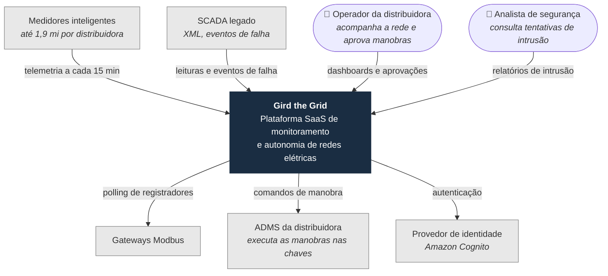
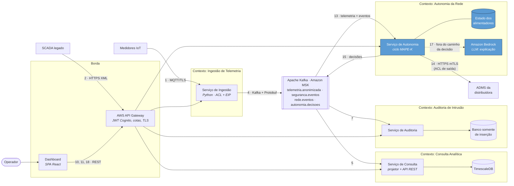
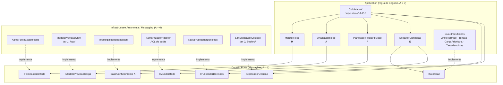

# 3. Visão Geral da Arquitetura (Modelo C4)

A arquitetura está documentada nos três primeiros níveis do Modelo C4. Os diagramas estão em Mermaid, que o GitHub desenha direto na página.

## 3.1. Nível 1: Diagrama de Contexto

Visão de negócio, sem tecnologia: quem usa a plataforma e com quais sistemas externos ela conversa.

## 3.2. Nível 2: Diagrama de Contêineres

Evolução do diagrama da Sprint 3 com o **Serviço de Autonomia (MAPE-K)**. O tráfego norte-sul (SCADA e *dashboard*) entra pelo **AWS API Gateway**; o tráfego leste-oeste passa só pelo **Apache Kafka (Amazon MSK)**. As linhas tracejadas são os limites de cada *Bounded Context*.

### Matriz de integração

Fluxos 1 a 11 vêm da Sprint 3 ([ADR-009](adr/ADR-009.md)); fluxos 12 a 18 são novos da entrega final ([ADR-013](adr/ADR-013.md)).

| Nº | Origem → destino | Protocolo | Natureza |
|---|---|---|---|
| 1 | Medidores → Ingestão | MQTT 3.1.1 sobre TLS, QoS 1 | Assíncrono |
| 2 | SCADA → API Gateway → Ingestão | HTTPS com XML, resposta 202 | Assíncrono (aceite imediato) |
| 3 | Ingestão → gateways Modbus | Modbus/TCP por *polling* | Síncrono |
| 4 | Ingestão → Kafka | Protocolo Kafka com Protobuf | Assíncrono |
| 5 | Kafka → Consulta (projetor) | Grupo de consumidores | Assíncrono |
| 6 | Consulta → TimescaleDB | PostgreSQL | Síncrono |
| 7 | Kafka → Auditoria | Tópicos `seguranca.eventos` e `autonomia.decisoes` | Assíncrono |
| 8 | Auditoria → banco de auditoria | PostgreSQL, somente inserção | Síncrono |
| 9 | Operador → Dashboard | HTTPS | Síncrono |
| 10 | Dashboard → API de Consulta | REST/JSON (OpenAPI) | Síncrono |
| 11 | Dashboard → API de Auditoria | REST/JSON (OpenAPI) | Síncrono |
| 12 | SCADA → Ingestão → Kafka | Evento `EVENTO_REDE` roteado pelo *Content-Based Router* para `rede.eventos` | Assíncrono |
| 13 | Kafka → Autonomia | Grupo de consumidores (`telemetria.anonimizada`, `rede.eventos`) | Assíncrono |
| 14 | Autonomia → ADMS | HTTPS com mTLS, *timeout* de 2 s e *circuit breaker* | Síncrono (externo) |
| 15 | Autonomia → Kafka | Tópico `autonomia.decisoes` | Assíncrono |
| 16 | Kafka → Auditoria | Registro imutável de cada decisão autônoma | Assíncrono |
| 17 | Autonomia → Amazon Bedrock | HTTPS; só para explicar a decisão | Assíncrono em relação à decisão |
| 18 | Dashboard → API de Autonomia | REST/JSON: aprovar ou recusar decisões pendentes | Síncrono |

Nenhum serviço chama outro serviço de *backend* de forma síncrona (regra herdada da ADR-005 e verificada na ADR-009). As únicas chamadas síncronas são com o legado, com o ADMS, com os bancos de cada serviço e com o *dashboard*.

## 3.3. Nível 3: Diagrama de Componentes do Serviço de Autonomia

O serviço escolhido para o Nível 3 é o da entrega final. Cada componente é uma classe real de `src/`, e as setas respeitam a regra de dependência: Application depende só de abstrações de Domain.Ports, e as implementações de Infrastructure são injetadas pela raiz de composição.

