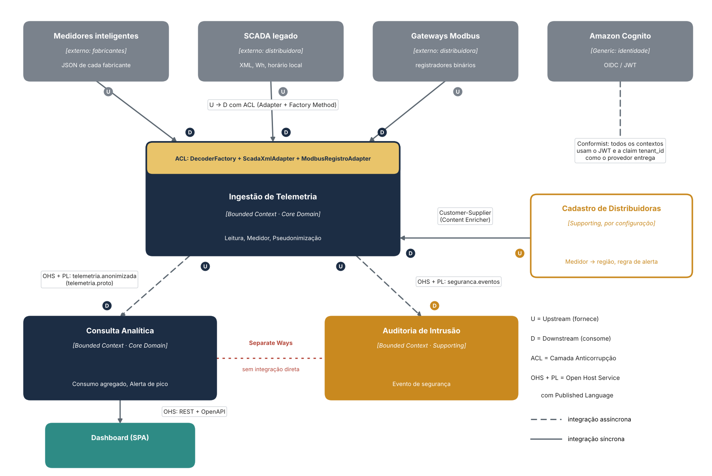

# 4. Domain-Driven Design (DDD) & Limites de Contexto

## 4.1. Classificação dos Subdomínios

| Subdomínio | Tipo | O que resolve | Diretriz |
|---|---|---|---|
| Monitoramento de Telemetria (Ingestão e Consulta Analítica) | ***Core Domain*** | Recebe 2.111 leituras por segundo de protocolos diferentes, pseudonimiza na borda e entrega consumo agregado e alertas de pico ao operador em tempo quase real | Desenvolvimento próprio, com a melhor engenharia da equipe e testes de contrato |
| Autonomia da Rede (MAPE-K) | ***Core Domain*** *(entrega final)* | Redistribui carga automaticamente quando uma subestação falha, dentro de guardrails físicos | Desenvolvimento próprio; é o principal diferencial do produto |
| Auditoria de Intrusão | *Supporting* | Registro imutável de tentativas de acesso indevido e de toda decisão autônoma | Desenvolvimento interno simples |
| Cadastro de Distribuidoras e Medidores | *Supporting* | Associa medidor, região e distribuidora e guarda a regra de alerta de cada cliente (ADR-008) | Configuração versionada lida pelos serviços |
| Identidade e Acesso | *Generic* | Login de operadores, *tokens* e credenciais do SCADA | Comprar: Amazon Cognito (OIDC e JWT) |
| Mensageria e esquemas | *Generic* | Transporte de eventos e versão do contrato `telemetria.proto` | Usar pronto: Kafka (Amazon MSK) e Glue Schema Registry |
| IA generativa | *Generic* | Explicar decisões em linguagem natural | Usar pronto: Amazon Bedrock |
| Notificações e observabilidade | *Generic* | E-mail, SMS, métricas, *logs* e rastreamento | Usar pronto: serviço de notificação da nuvem e OpenTelemetry |

## 4.2. Linguagem Ubíqua (Core Domain)

O nome no código é o mesmo usado por operadores e engenheiros de distribuição.

| Termo | Significado no negócio | Nome no código |
|---|---|---|
| Leitura | Medição de energia de um medidor num instante, em kWh e UTC | `ITelemetryReading` (`telemetria.proto`) |
| Medidor | Equipamento na unidade consumidora; na plataforma só aparece pseudonimizado | `device_id` |
| Distribuidora | Empresa cliente do SaaS, dona dos medidores e dos dados | `tenant_id` |
| Pseudonimização | Troca do identificador real do medidor por um código, feita na borda (LGPD) | `Pseudonimizador.pseudonimizar()` |
| Consumo agregado | Soma das leituras de um medidor ou região numa janela de tempo | `IConsumoAgregado` |
| Alerta de pico | Aviso quando o consumo passa da regra da distribuidora | `IAlertaPicoStrategy` |
| Evento de segurança | Violação do medidor ou tentativa de acesso indevido | `seguranca.eventos` |
| Pico pós-blecaute | Rajada de leituras acumuladas quando a energia volta | Nome do cenário nos testes de carga |
| Alimentador | Circuito que sai de uma subestação e atende uma região | `IEstadoAlimentador` |
| Chave de interligação | Chave que liga dois alimentadores e permite transferir carga | `Manobra.chave_id` |
| Manobra | Abertura ou fechamento de chave para transferir carga | `Manobra` / `IPlanoRedistribuicao` |
| Carga prioritária | Hospital, saneamento ou outra carga essencial, religada primeiro | `IEstadoAlimentador.prioritario` |
| Guardrail | Limite físico que nenhuma decisão automática pode violar | `IGuardrail` |

Os contratos da Sprint 2 têm nomes em inglês (`TelemetryReading`), enquanto o resto do código usa português. Eles foram mantidos para não quebrar o contrato publicado, e todo nome novo segue o glossário ([ADR-010](adr/ADR-010.md)).

## 4.3. Mapa de Contexto e Camada Anti-Corrupção (ACL)

A palavra "leitura" mostra por que os limites importam. No SCADA, ela é um elemento XML em Wh e horário local; na Ingestão, uma `TelemetryReading` em kWh e UTC; na Consulta, um ponto agregado de série temporal. Cada contexto tem seu modelo, e a tradução só acontece nas fronteiras.

| *Upstream* (fornece) | *Downstream* (consome) | Padrão | Implementação |
|---|---|---|---|
| Medidores inteligentes | Ingestão | ACL | `DecoderFactory` escolhe o decodificador de cada fabricante (ADR-006) |
| SCADA legado | Ingestão | ACL | `ScadaXmlAdapter` converte XML, Wh e horário local (ADR-007) |
| Gateways Modbus | Ingestão | ACL | `ModbusRegistroAdapter` traduz os registradores binários |
| Ingestão | Consulta Analítica | OHS + *Published Language* | Tópico `telemetria.anonimizada` com `telemetria.proto` (ADR-009) |
| Ingestão | Auditoria de Intrusão | OHS + *Published Language* | Tópico `seguranca.eventos` |
| Ingestão | Autonomia da Rede | OHS + *Published Language* | Tópicos `telemetria.anonimizada` e `rede.eventos` |
| Autonomia da Rede | Auditoria de Intrusão | OHS + *Published Language* | Tópico `autonomia.decisoes` |
| Autonomia da Rede | ADMS da distribuidora | ACL (saída) | `AdmsAtuadorAdapter` traduz o plano para o comando do fornecedor (ADR-013) |
| Consulta Analítica | Dashboard | OHS | API REST descrita em OpenAPI |
| Cadastro de Distribuidoras | Ingestão | *Customer-Supplier* | *Content Enricher* busca a região de cada medidor |
| Amazon Cognito | Todos os contextos | *Conformist* | JWT e a claim `tenant_id` usados como o provedor entrega |
| Consulta Analítica | Auditoria de Intrusão | *Separate Ways* | Não se integram: cada uma lê o Kafka e tem seu banco |

Toda entrada de sistema externo passa por uma ACL localizada em `src/infrastructure/protocolos/`, e toda saída para sistema externo passa por uma ACL em `src/infrastructure/autonomia/`. Toda comunicação entre contextos internos usa OHS com linguagem publicada. O único ponto *Conformist* é a identidade, porque o formato do JWT é padronizado.
