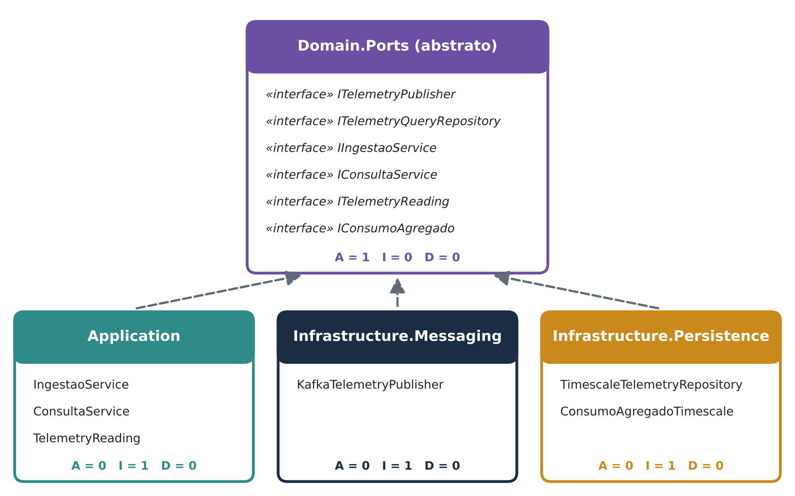
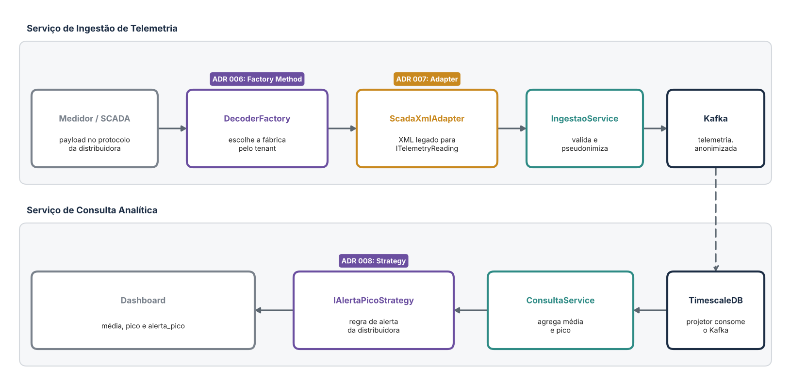
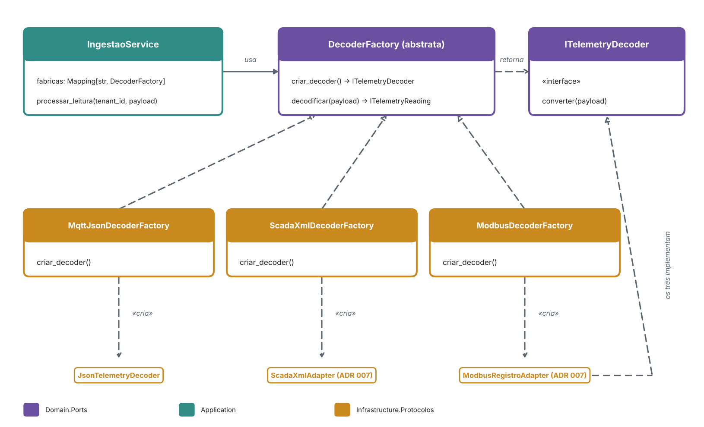
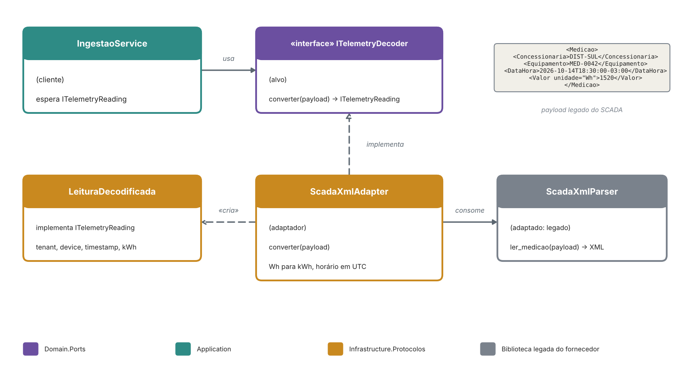
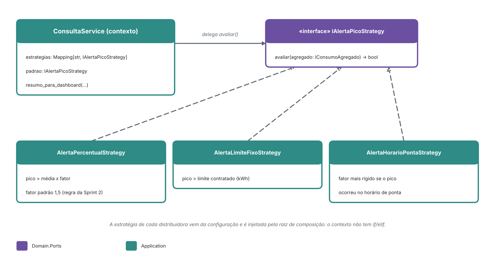

# 5. Padrões de Projeto & Princípios SOLID

## 5.1. Princípios SOLID Aplicados

- **Dependency Inversion Principle (DIP):** o domínio declara as interfaces de repositórios e serviços em `src/domain/ports/` (`ITelemetryPublisher`, `ITelemetryQueryRepository`, `IAtuadorRede`, `IModeloPrevisaoCarga`…), e a infraestrutura fornece as implementações concretas em `src/infrastructure/` (`KafkaTelemetryPublisher`, `TimescaleTelemetryRepository`, `AdmsAtuadorAdapter`, `ModeloPrevisaoOnnx`…). As implementações são injetadas via construtor ([ADR-003](adr/ADR-003.md)).
- **Open/Closed Principle (OCP):** um novo protocolo, um novo formato legado, uma nova regra de alerta ou um novo guardrail entram como uma classe nova, sem alterar `IngestaoService`, `ConsultaService` ou `ExecutorManobras`.
- **Single Responsibility Principle (SRP):** criação de objetos (fábricas), conversão de formato (adaptadores), regra de alerta (estratégias) e cada etapa do MAPE-K ficam em classes separadas, cada uma com um único motivo para mudar.
- **Interface Segregation Principle (ISP):** a comunicação entre camadas usa contratos de dados do domínio (`ITelemetryReading`, `IConsumoAgregado`, `IEstadoAlimentador`), e nenhum tipo do Kafka, do `psycopg2` ou do ADMS vaza para a regra de negócio.

### Métricas de acoplamento

As métricas de Robert C. Martin passaram por três momentos. Na Sprint 2, o Domain tinha D = 0,67; a separação em Domain.Ports e Application ([ADR-004](adr/ADR-004.md)) levou todos os pacotes a D = 0. Na entrega final, o cálculo deixou de ser manual: o script `fitness/metricas.py` lê o código e gera o relatório a cada *pull request* (ver [seção 8](08-fitness-functions.md)).

| Momento | Pacote do núcleo | A | I | D |
|---|---|---|---|---|
| Sprint 2, diagnóstico | Domain | 0,33 | 0 | 0,67 |
| Sprint 2, 1ª refatoração | Domain | 0,50 | 0 | 0,50 |
| Sprint 2, ADR-004 | Domain.Ports | 1 | 0 | 0 |
| Entrega final (automático) | Domain.Ports | 1 | 0 | 0 |

## 5.2. Catálogo de Padrões GoF Utilizados

Os nove padrões das três famílias foram avaliados com quatro perguntas: resolve um problema real, preserva as decisões anteriores, favorece o OCP e o custo compensa. Um padrão de cada família foi escolhido.

| Padrão GoF | Categoria | Localização no Código | Problema de Engenharia Resolvido |
|---|---|---|---|
| **Factory Method** | Criacional | `src/domain/ports/protocolos.py` (`DecoderFactory`) e `src/infrastructure/protocolos/decoders.py` (`MqttJsonDecoderFactory`, `ScadaXmlDecoderFactory`, `ModbusDecoderFactory`) | Instanciar o decodificador do protocolo de cada distribuidora em tempo de execução, sem acoplar o `IngestaoService` a classes concretas ([ADR-006](adr/ADR-006.md)) |
| **Adapter** | Estrutural | `src/infrastructure/protocolos/decoders.py` (`ScadaXmlAdapter`, `ModbusRegistroAdapter`) e `src/infrastructure/autonomia/adaptadores.py` (`AdmsAtuadorAdapter`) | Traduzir XML do SCADA e registradores Modbus para `ITelemetryReading` (entrada) e o plano de manobras para o comando do ADMS (saída) ([ADR-007](adr/ADR-007.md)) |
| **Strategy** | Comportamental | `src/domain/ports/alerta.py` (`IAlertaPicoStrategy`), `src/application/alertas.py` e, no MAPE-K, `IGuardrail` em `src/application/autonomia.py` | Eliminar `if/else` de regra de alerta por distribuidora e permitir combinar guardrails físicos como algoritmos intercambiáveis ([ADR-008](adr/ADR-008.md)) |

| Factory Method | Adapter | Strategy |
|---|---|---|
|  |  |  |

### Padrões avaliados e rejeitados

| Padrão | Motivo da rejeição |
|---|---|
| Abstract Factory | Não existe família de objetos; a troca da infraestrutura já é resolvida por injeção via construtor |
| Singleton | Estado global impede dublês de teste |
| Decorator | Resolve observabilidade, preocupação secundária; fica como evolução |
| Facade | Em microsserviços vira API Gateway e reacopla os serviços |
| Observer | O Kafka já faz publicação e assinatura entre serviços |
| Command | Rejeitado na Sprint 3 (o sistema só monitorava). Revisitado na ADR-013: o plano de manobras é um objeto de dados auditado, sem "desfazer", porque a reversão física também precisa passar pelos guardrails |
