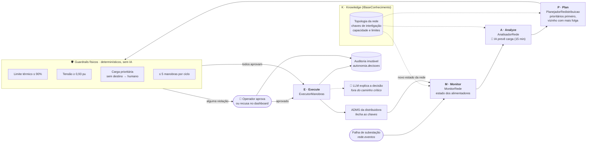

# 6.2. Componente de Inteligência Artificial: Ciclo Autônomo MAPE-K

Desafio final do Gird the Grid: quando uma subestação falha, a plataforma deve redistribuir a carga automaticamente para alimentadores vizinhos, com IA para otimizar a decisão e guardrails que protejam a rede física. A decisão completa está na [ADR-013](adr/ADR-013.md), e o código, em `src/application/autonomia.py`.

## Ciclo MAPE-K com Guardrails de segurança física

O ciclo fecha pelo próprio sistema gerenciado: depois da manobra, os medidores e o SCADA passam a reportar o novo estado, que volta ao Monitor no ciclo seguinte.

## Arquitetura AI-Native

**Model Tiering.** A IA foi dividida em dois níveis, de acordo com o risco e a latência de cada uso:

| Nível | Modelo | Onde roda | Papel | Se falhar |
|---|---|---|---|---|
| Tier 1 | Modelo leve de previsão de carga (exportado em ONNX) | Dentro do Serviço de Autonomia, sem rede | Prever a carga dos próximos 15 min de cada alimentador. Está no caminho da decisão | *Fallback* para a última carga medida |
| Tier 2 | LLM em nuvem (Amazon Bedrock, sa-east-1) | Serviço gerenciado | Explicar ao operador, em linguagem natural, por que o plano foi executado ou bloqueado | Texto padrão; a decisão não muda |

A escolha evita depender de um provedor externo no momento mais crítico (pós-blecaute) e mantém a parte probabilística longe da decisão sobre segurança. A IA **prevê**; quem **decide se é seguro** são regras determinísticas.

Não foi usado RAG nem sistema multiagente: o conhecimento necessário (topologia e limites) é estruturado e consultado diretamente pela base K. Um LLM planejando manobras poderia inventar uma chave inexistente, risco inaceitável em rede elétrica.

## Guardrails & Segurança

- **Guardrails físicos:** implementados como Strategy (`IGuardrail`), combináveis e testados um a um. Qualquer violação bloqueia o envio de comandos e escala para o operador (humano no circuito).
- **Saída estruturada:** a resposta do LLM é validada por JSON Schema (`{resumo, riscos}`, sem campos extras); fora do formato, é descartada.
- **Higienização de PII:** o MAPE-K trabalha só com dados agregados por alimentador. Nenhum `device_id`, endereço ou dado de consumidor chega ao modelo ou ao LLM (LGPD), o que é garantido pelo próprio contrato `IEstadoAlimentador`.
- **Auditoria:** toda decisão (executada, pendente ou sem ação) é publicada em `autonomia.decisoes` e gravada no banco somente de inserção.
- **Implantação gradual:** modo sombra por distribuidora antes de ativar a execução, e um botão de desligamento (*kill switch*) que manda tudo para aprovação humana.

## Cenários testados

Os cenários abaixo rodam no CI com dublês (sem Kafka, IA ou ADMS reais), em `fitness/test_mapek.py`:

| Cenário | Resultado esperado |
|---|---|
| Subestação falha e há vizinho com folga | `EXECUTADO`, carga vai para o vizinho com mais folga e a decisão é auditada |
| Vizinho passaria de 90% da capacidade | `PENDENTE_APROVACAO`, nenhum comando enviado |
| Tensão estimada abaixo de 0,93 pu | `PENDENTE_APROVACAO`, nenhum comando enviado |
| Hospital sem alimentador disponível | `PENDENTE_APROVACAO`, alimentador listado em `sem_destino` |
| Carga prioritária e comum afetadas juntas | A prioritária é manobrada primeiro |
| Modelo de IA fora do ar | Usa a última medição e segue funcionando |
| Rede normal | `SEM_ACAO` |
