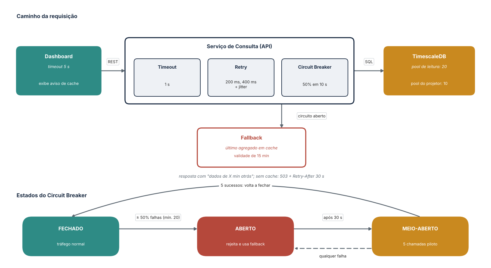
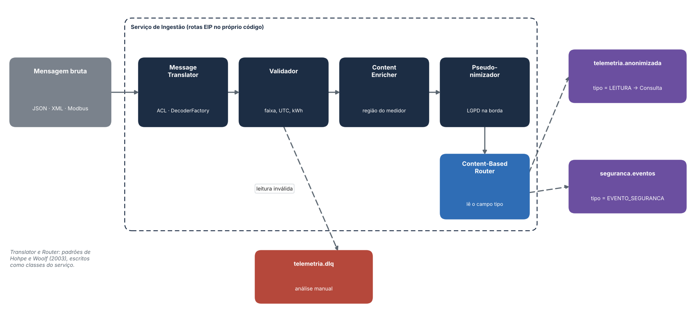

# 6.1. Resiliência e Integração

## Padrões de Resiliência Aplicados

### Circuit Breaker & Fallback

O elo mais fraco é a chamada do *dashboard* ao Serviço de Consulta, que lê o TimescaleDB: é o único caminho síncrono diante do usuário e depende de um banco que, no pico pós-blecaute, também recebe a escrita acumulada do projetor. Sem proteção, consultas lentas prendem as *threads* da API (*thread starvation*) e o operador fica sem visão da rede quando mais precisa dela.

| Mecanismo | Valor | Justificativa |
|---|---|---|
| *Timeout* | 1 s por consulta | Dobro da meta de 500 ms (ADR-002); acima disso a *thread* é liberada |
| *Retry* | Até 2 tentativas (200 ms e 400 ms) com *jitter* de até 50% | Só para leituras idempotentes; o *jitter* evita que todas as instâncias tentem ao mesmo tempo |
| Orçamento total | ≈ 3,6 s, contra 5 s de *timeout* no *dashboard* | O cliente desiste depois das tentativas do servidor, nunca antes |
| *Circuit breaker*: abertura | 50% de falhas em 10 s, mínimo de 20 chamadas | Não abre por duas falhas isoladas |
| *Circuit breaker*: aberto | 30 s rejeitando de imediato | Dá tempo para o banco escoar a fila de escrita |
| *Circuit breaker*: meio-aberto | 5 chamadas piloto | Testa a recuperação com carga controlada |
| *Fallback* | Último agregado válido em *cache* (validade de 15 min), com aviso "dados de X minutos atrás"; sem *cache*, 503 com `Retry-After` | O operador continua vendo a rede |

A mesma tática protege a chamada do Serviço de Autonomia ao ADMS da distribuidora (fluxo 14): *timeout* de 2 s, sem *retry* automático de comando físico (uma manobra repetida pode ter efeito diferente) e, com o circuito aberto, a decisão vai para `PENDENTE_APROVACAO`.

### Nivelamento de Carga (*Load Leveling*)

O Kafka absorve o pico pós-blecaute: a Ingestão publica no ritmo em que as leituras chegam, e o projetor da Consulta consome no ritmo que o banco aguenta ([ADR-001](adr/ADR-001.md)). Com retenção de 7 dias, o log permite reconstruir o TimescaleDB depois de uma falha longa ([ADR-012](adr/ADR-012.md)).

### Complementares

- ***Bulkhead*:** *pools* de conexão separados para a API de leitura (20 conexões) e para o projetor (10), para que a escrita acumulada não consuma as conexões do *dashboard*.
- ***Dead Letter Queue*:** mensagens que falham na desserialização do Protobuf (*poison pills*) vão para `telemetria.dlq` depois de 3 tentativas. A partição continua andando e nenhum dado se perde.
- **Idempotência:** como MQTT QoS 1 e Kafka entregam "ao menos uma vez", o projetor grava com a chave `device_id` + `timestamp`.

## Integração

### Protocolos por natureza do fluxo ([ADR-009](adr/ADR-009.md))

| Fluxo | Protocolo | Por quê |
|---|---|---|
| Borda (medidores) | MQTT sobre TLS, QoS 1 | Leve para redes de pouca banda |
| Borda (legado) | HTTPS com 202 (SCADA) e Modbus/TCP | Compatibilidade, isolada por adaptadores |
| Entre serviços | Apache Kafka com Protobuf (`contratos/telemetria.proto`) | Assíncrono, retém e reprocessa; mensagem 2,9 vezes menor que em JSON |
| *Dashboard* | REST sobre HTTPS com JSON (OpenAPI) | Nativo do navegador |

### API Gateway e padrões EIP ([ADR-011](adr/ADR-011.md))

O **AWS API Gateway** é a porta do tráfego norte-sul: termina o TLS, valida o JWT do Cognito, recusa requisições sem `tenant_id` e aplica cotas por distribuidora (um SCADA que reenvia tudo no pós-blecaute recebe 429 em vez de derrubar a API).

Dentro do Serviço de Ingestão, os padrões EIP são classes do próprio serviço, sem barramento externo:

- ***Message Translator*:** `DecoderFactory` + adaptadores (é a própria ACL).
- **Validador:** leitura inválida segue direto para `telemetria.dlq`.
- ***Content Enricher*:** busca a região do medidor no cadastro, usada como chave de partição.
- **Pseudonimizador:** troca o identificador real antes de qualquer publicação.
- ***Content-Based Router*:** `LEITURA` vai para `telemetria.anonimizada`, `EVENTO_SEGURANCA` para `seguranca.eventos` e, na entrega final, `EVENTO_REDE` (falha de subestação vinda do SCADA) para `rede.eventos`.

