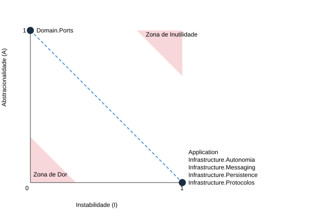

# 8. Testes & Fitness Functions (Governança Automatizada)

As regras de arquitetura das ADRs deixaram de depender só de revisão de código: elas viraram testes que rodam em todo *pull request* pelo GitHub Actions (`.github/workflows/fitness-functions.yml`). Se uma regra for violada, o PR fica vermelho e não deve ser aprovado.

## 8.1. Execução das Fitness Functions

O projeto é em Python, então o papel do ArchUnit é feito por um script próprio, `fitness/metricas.py`, que lê o código de `src/` com o módulo `ast` (sem executar nada) e verifica:

| Regra | O que verifica | Origem |
|---|---|---|
| **Regra Validada 1** | A camada de Domínio (Domain.Ports) não possui referência a Application nem a Infrastructure | ADR-003 |
| **Regra Validada 2** | Toda classe de Infrastructure (repositórios, adaptadores, *publishers*) implementa uma interface abstrata de Domain.Ports | ADR-003 e ADR-007 |
| R2 | Application não importa nada de Infrastructure | ADR-004 |
| R3 | Bibliotecas de fornecedor (`confluent_kafka`, `psycopg2`, `boto3`, `onnxruntime`, `requests`, `jsonschema`) só aparecem em Infrastructure | ADR-003, 010 e 013 |
| R5 | Domain.Ports só contém abstrações (A = 1) | ADR-004 |
| R6 | Todo pacote está a no máximo 0,1 da sequência principal (D ≤ 0,1) | ADR-004 |

Um dos testes prova que a regra funciona: ele injeta uma classe concreta em Domain.Ports e confirma que a verificação reprova.

## 8.2. Cálculo automatizado de Instabilidade (I) e Abstracionalidade (A)

O script descobre as classes de cada pacote e quais classes de outros pacotes cada uma usa, e calcula Ca, Ce, I = Ce / (Ca + Ce), A = Na / Nc e D = |A + I − 1|. Resultado atual:

| Pacote | Nc | Na | A | Ca | Ce | I | D |
|---|---|---|---|---|---|---|---|
| Domain.Ports | 19 | 19 | 1,00 | 33 | 0 | 0,00 | **0,00** |
| Application | 18 | 0 | 0,00 | 0 | 16 | 1,00 | **0,00** |
| Infrastructure.Autonomia | 6 | 0 | 0,00 | 0 | 6 | 1,00 | **0,00** |
| Infrastructure.Messaging | 2 | 0 | 0,00 | 0 | 2 | 1,00 | **0,00** |
| Infrastructure.Persistence | 2 | 0 | 0,00 | 0 | 2 | 1,00 | **0,00** |
| Infrastructure.Protocolos | 7 | 0 | 0,00 | 0 | 7 | 1,00 | **0,00** |



Domain.Ports fica no canto estável e abstrato (I = 0, A = 1) e todos os outros pacotes no canto instável e concreto (I = 1, A = 0). Todos estão sobre a sequência principal, e nenhum cai na Zona de Dor ou na Zona de Inutilidade. Domain.Ports não é inútil, apesar de A = 1, porque tem 33 classes dependendo dele.

Em relação à Sprint 3 (Domain.Ports com 9 abstrações), o MAPE-K acrescentou 10 abstrações e 2 pacotes concretos sem tirar nenhum pacote da sequência principal. O relatório completo é regerado a cada PR em [relatorio-metricas.md](relatorio-metricas.md).

## Como rodar

```bash
python fitness/metricas.py --relatorio docs/relatorio-metricas.md   # métricas + regras
python -m unittest discover -s fitness -v                           # 13 testes
```

Requer só Python 3.10 ou mais recente, sem dependências externas: o script lê o código, não o executa, por isso as bibliotecas de fornecedor não precisam estar instaladas.
