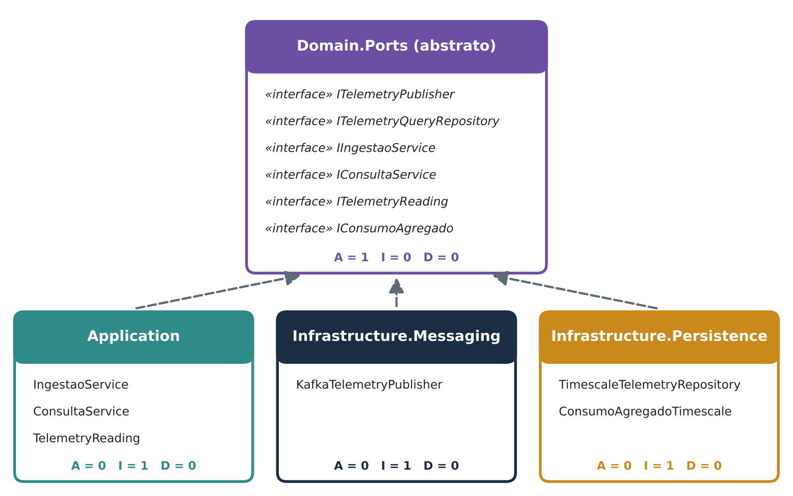
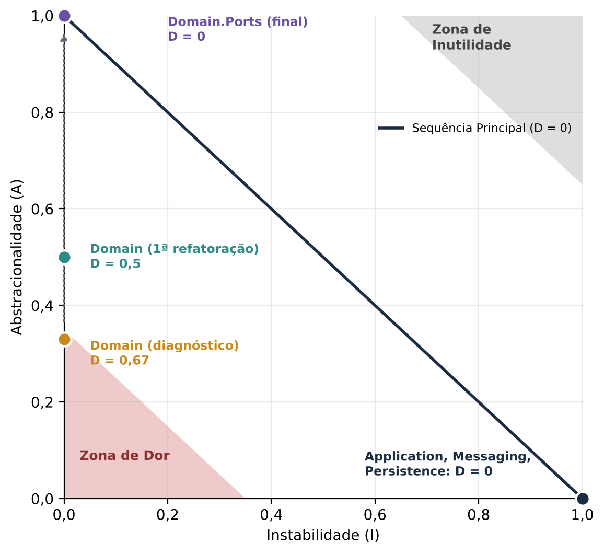

# ADR-004: Separação do Núcleo em Domain.Ports e Application para Zerar a Distância da Sequência Principal

| Status | Data | Responsável |
|---|---|---|
| Aceito | 2026-09-16 | Daniel (Líder da Sprint 2) |

> **Nota:** Desde a Sprint 4, essas métricas são calculadas automaticamente por `fitness/metricas.py` (ver docs/08-fitness-functions.md).

## Contexto

As métricas de Robert C. Martin aplicadas aos três pacotes primários (detalhe em docs/05-solid-gof.md) mostraram os adaptadores de infraestrutura sobre a Sequência Principal (D = 0) e o **Domain** fora dela: I = 0 e A = 0,33, com **D = 0,67**.

Uma primeira refatoração, que extraiu `IIngestaoService` e `IConsultaService`, elevou A para 0,5 e reduziu D para 0,5. Como o pacote tem I = 0, D só chega a zero com A = 1, e isso exige que nenhuma classe concreta permaneça nele.

## Decisão

Dividir o Domain em dois pacotes:

- **Domain.Ports** contém apenas abstrações: `ITelemetryPublisher`, `ITelemetryQueryRepository`, `IIngestaoService`, `IConsultaService` e os contratos abstratos `ITelemetryReading` e `IConsumoAgregado`
- **Application** contém as implementações concretas `IngestaoService`, `ConsultaService` e `TelemetryReading`
- A implementação concreta do agregado (`ConsumoAgregadoTimescale`) fica em **Infrastructure.Persistence**, que a constrói

Resultado: **D = 0 nos quatro pacotes**.

## Alternativas rejeitadas

1. **Manter D = 0,5 alegando que DTOs são concretos por natureza** (versão anterior desta ADR): contraria a meta da auditoria, e a separação resolve sem distorcer o modelo.
2. **Mover apenas os DTOs para um pacote Domain.Model:** ele seria concreto e estável (A = 0, I = 0) e cairia na Zona de Dor, com D = 1.
3. **Deixar os DTOs concretos em Application:** as assinaturas de Domain.Ports passariam a depender de Application, criando ciclo entre pacotes e tirando Ports da estabilidade.
4. **Criar pacotes artificiais só para alterar a fórmula:** manipulação da métrica, sem ganho de design.

## Consequências

**Positivas:**
- Todos os pacotes ficam sobre a Sequência Principal
- A regra de negócio em Application pode ser testada com dublês (fakes e mocks) das interfaces, sem Kafka nem banco real
- A troca de tecnologia continua confinada aos adaptadores; os contratos em Domain.Ports são o único ponto estável compartilhado

**Negativas (trade-offs):**
- Um pacote a mais e duas interfaces de DTO para manter sincronizadas com suas implementações
- Contratos abstratos de dados são menos naturais em Python (exigem classes abstratas com propriedades)
- Na topologia de microsserviços da ADR 005, Domain.Ports não pode virar biblioteca compartilhada entre serviços: cada serviço carrega apenas as portas do próprio contexto, e as métricas são recalculadas por quantum

## Governança

- Fitness function no pipeline de CI: o build falha se Domain.Ports contiver classe concreta (A < 1) ou importar outro pacote (Ce > 0)
- Recalcular Ca, Ce, I, A e D sempre que uma classe ou pacote for adicionado
- Revisão de código: importações de `confluent_kafka` ou `psycopg2` fora da infraestrutura são rejeitadas (regra herdada da ADR 003)
- Todo novo serviço de aplicação nasce com sua interface em Domain.Ports

