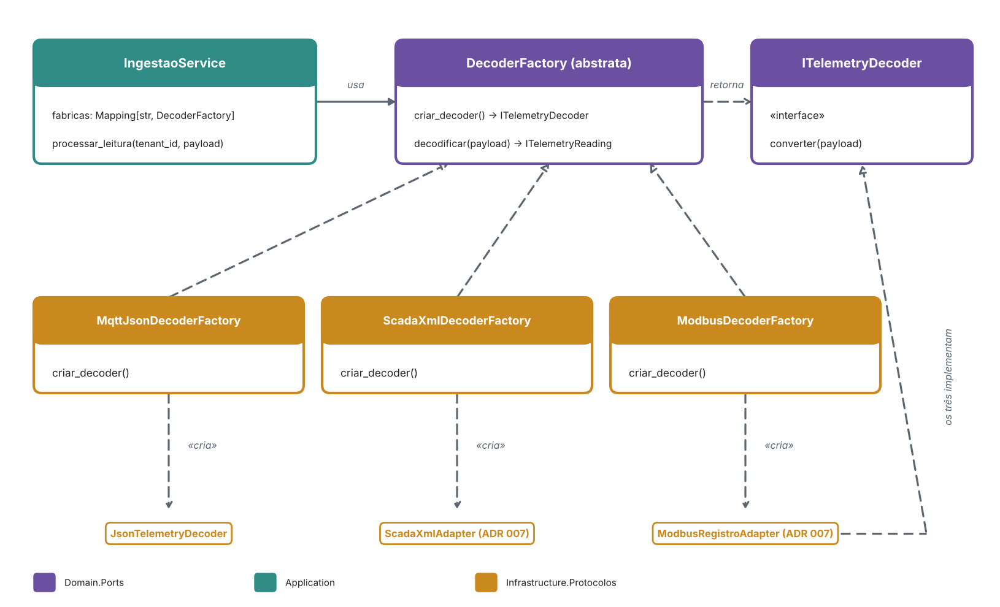

# ADR-006: Adoção do Factory Method para criar o decodificador de protocolo de cada distribuidora

| Status | Data | Responsável |
|---|---|---|
| Aceito | 2026-10-14 | Caio (Líder da Sprint 3) |

## Contexto

Cada distribuidora envia telemetria em um protocolo próprio (MQTT/JSON, XML de SCADA legado ou Modbus), e o decodificador adequado só é conhecido em tempo de execução, a partir da configuração do cliente. Um bloco if/elif por protocolo no IngestaoService violaria o OCP a cada novo cliente e acoplaria a regra de negócio às bibliotecas de protocolo, violando o DIP.

## Decisão

Criar em Domain.Ports o criador abstrato DecoderFactory, com o Factory Method criar_decoder() e a operação decodificar(payload), que usa o produto de forma polimórfica. As fábricas concretas MqttJsonDecoderFactory, ScadaXmlDecoderFactory e ModbusDecoderFactory ficam no novo pacote Infrastructure.Protocolos. A raiz de composição lê o protocolo de cada distribuidora na configuração e entrega ao IngestaoService, via construtor, um mapa de fábricas indexado por tenant_id.

## Alternativas rejeitadas

(1) Bloco if/elif por protocolo no IngestaoService: viola o OCP e o DIP. (2) Abstract Factory: não existe uma família de objetos que precise ser criada em conjunto, e a troca da infraestrutura inteira já é resolvida pela injeção via construtor da ADR 003. (3) Singleton para o decodificador ou para o produtor Kafka: introduz estado global e impede a troca por dublês nos testes; quando uma instância única é desejável, a raiz de composição cria um único objeto e o injeta, sem precisar do padrão.

## Consequências positivas

Um novo protocolo entra com uma fábrica e um decodificador novos, mais uma linha no registro de protocolos, sem alterar o IngestaoService. O serviço pode ser testado com uma fábrica falsa, sem *payload* real de nenhum fornecedor. Distribuidoras com protocolos diferentes convivem no mesmo serviço de ingestão.

## Consequências negativas

Uma fábrica concreta para cada protocolo, o que aumenta o número de classes. A assinatura de IIngestaoService muda para processar_leitura(tenant_id, payload), e o ponto de entrada do serviço precisa ser ajustado. Uma distribuidora configurada com um protocolo inexistente só seria percebida em tempo de execução, risco tratado na governança.

## Governança

Validação na inicialização (*fail-fast*): o serviço não sobe se alguma distribuidora ativa apontar para um protocolo sem fábrica registrada. *Fitness function* no CI: o *build* falha se Application importar qualquer classe de Infrastructure.Protocolos. Cada fábrica concreta tem teste unitário que verifica o tipo de decodificador criado.

