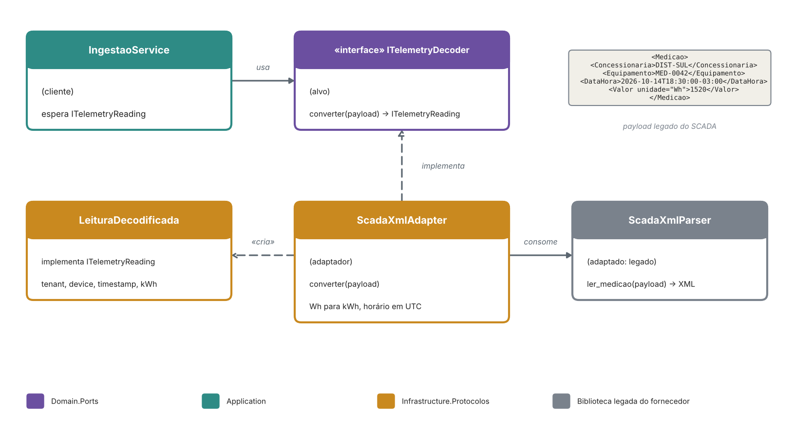

# ADR-007: Adoção do Adapter para integrar medidores e SCADA legados ao contrato ITelemetryReading

| Status | Data | Responsável |
|---|---|---|
| Aceito | 2026-10-14 | Caio (Líder da Sprint 3) |

## Contexto

As fontes de telemetria das distribuidoras expõem interfaces incompatíveis com o domínio: XML de SCADA com valores em Wh e horário local, e registradores Modbus com fator de escala. O domínio espera ITelemetryReading em kWh e UTC, e a validação e a pseudonimização (LGPD) foram escritas sobre esse contrato. As interfaces legadas não podem ser alteradas pela equipe.

## Decisão

Criar em Domain.Ports a interface alvo ITelemetryDecoder, cujo método converter(payload) devolve um ITelemetryReading. Para cada formato legado há um adaptador em Infrastructure.Protocolos: ScadaXmlAdapter envolve a biblioteca do SCADA (o adaptado), lê o XML e converte Wh para kWh e o horário local para UTC; ModbusRegistroAdapter combina os registradores e aplica o fator de escala. Os adaptadores devolvem LeituraDecodificada, implementação concreta de ITelemetryReading mantida no próprio pacote de infraestrutura, pelo mesmo motivo que levou ConsumoAgregadoTimescale para Infrastructure.Persistence na ADR 004. Formatos que já seguem o contrato, como o JSON via MQTT, usam um decodificador direto. Os adaptadores são criados pelas fábricas da ADR 006.

## Alternativas rejeitadas

(1) Exigir JSON de todas as distribuidoras: inviável comercialmente, pois obriga o cliente a trocar medidores ou SCADA. (2) Converter o legado dentro do IngestaoService: mistura leitura de XML e de registradores com regra de negócio e acopla Application às bibliotecas do fornecedor. (3) Decorator: acrescenta responsabilidades a um objeto que já tem a interface certa, mas não resolve interfaces incompatíveis; fica registrado como evolução para métricas no ITelemetryPublisher. (4) Facade: simplificaria o acesso do *dashboard* aos serviços, mas não trata a entrada heterogênea e, em microsserviços, tende a virar um API Gateway que reacopla Consulta e Auditoria.

## Consequências positivas

A heterogeneidade dos fornecedores fica confinada na borda do sistema, e a validação e a pseudonimização continuam escritas uma única vez, sobre ITelemetryReading. As conversões de unidade e de fuso horário ficam em um único lugar por formato. Uma mudança no formato de um fornecedor afeta apenas o seu adaptador.

## Consequências negativas

Um adaptador para cada formato legado e dependência de bibliotecas de terceiros em Infrastructure.Protocolos. A conversão consome CPU na ingestão, que recebe 2.111 requisições por segundo, de acordo com o BOTE da Sprint 1; por isso os adaptadores precisam ser leves e sem estado, o que permite escalar o serviço de ingestão horizontalmente (ADR 005). A conversão é frágil a mudanças de formato não comunicadas pelo fornecedor.

## Governança

Testes de contrato com amostras reais de *payload* de cada distribuidora, executados no CI a cada alteração de adaptador. Métrica de leituras rejeitadas por adaptador, com alerta quando a taxa sobe, sinal de mudança no formato do fornecedor. Na revisão de código, importações de bibliotecas de fornecedor fora de Infrastructure.Protocolos são rejeitadas, na mesma linha da regra da ADR 003 para Kafka e psycopg2.

