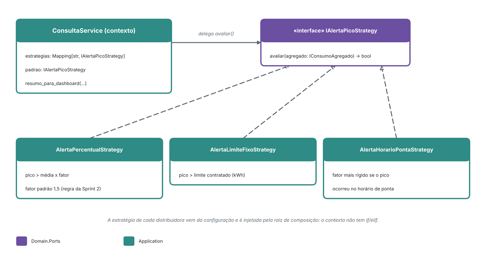

# ADR-008: Adoção do Strategy para a regra de alerta de pico de cada distribuidora

| Status | Data | Responsável |
|---|---|---|
| Aceito | 2026-10-14 | Caio (Líder da Sprint 3) |

## Contexto

A regra de alerta de pico está fixa no ConsultaService (pico > média x 1,5), mas cada distribuidora tem um critério próprio: percentual sobre a média, limite de demanda contratada ou rigor maior no horário de ponta. Acomodar essas variações com if/elif no serviço violaria o OCP e concentraria todas as regras em uma única classe.

## Decisão

Criar em Domain.Ports a interface IAlertaPicoStrategy, com o método avaliar(agregado). As estratégias concretas ficam em Application, por serem regra de negócio: AlertaPercentualStrategy (pico maior que a média multiplicada por um fator; com fator 1,5 reproduz a regra da Sprint 2), AlertaLimiteFixoStrategy (pico maior que um limite contratado em kWh) e AlertaHorarioPontaStrategy (fator mais rígido quando o pico ocorre no horário de ponta). O ConsultaService passa a ser o contexto: recebe via construtor um mapa de estratégias por tenant_id e uma estratégia padrão, e apenas delega a decisão. O contrato IConsumoAgregado ganha a propriedade instante_pico, necessária para a regra de horário de ponta.

## Alternativas rejeitadas

(1) Bloco if/elif por tipo de regra no ConsultaService: viola o OCP e concentra todas as regras em uma classe. (2) Observer: o problema não é notificar vários interessados, e sim escolher um algoritmo; além disso, a publicação de eventos entre serviços já é feita pelo Kafka (ADRs 001 e 005), e um Observer em memória duplicaria esse papel com um fluxo mais difícil de rastrear. (3) Command: encapsular ações para fila e desfazer não se aplica, pois o sistema monitora a rede e não envia comandos aos medidores.

## Consequências positivas

Cada distribuidora tem o seu critério de alerta sem alteração no ConsultaService, e uma nova regra entra como uma nova classe. Cada estratégia é testada isoladamente com um IConsumoAgregado falso. Distribuidoras sem configuração mantêm o comportamento atual, pois a estratégia padrão é a percentual com fator 1,5.

## Consequências negativas

Mais classes e parâmetros de alerta por distribuidora para manter na configuração. A ampliação do contrato IConsumoAgregado exige ajustar ConsumoAgregadoTimescale e a consulta ao TimescaleDB para devolver o instante do pico.

## Governança

Regra de análise estática no CI: o ConsultaService não pode conter condicionais sobre tenant_id ou tipo de regra. Cada estratégia tem testes unitários com casos de fronteira (pico exatamente igual ao limite, pico no início e no fim do horário de ponta). Alterações na regra de alerta de uma distribuidora são registradas, pois mudam o que o cliente vê no *dashboard*.

