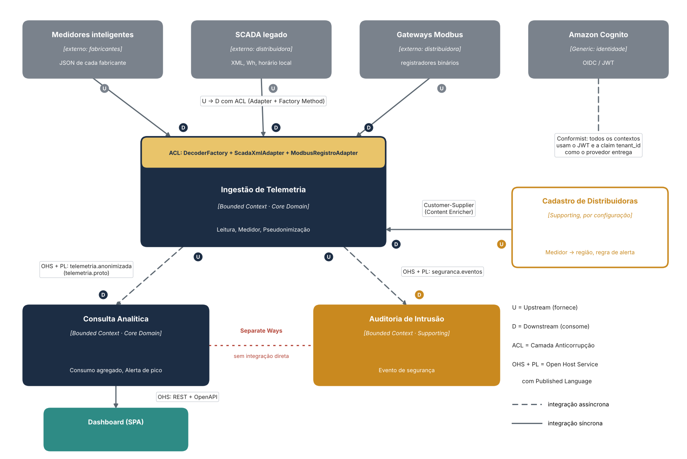

# ADR-010: Delimitação dos *Bounded Contexts* e Camada Anticorrupção na borda da Ingestão

| Status | Data | Responsável |
|---|---|---|
| Aceito | 2026-11-11 | Caio (Líder da Sprint 3) |

## Contexto

A ADR 005 criou três serviços, mas sem limites de modelo formalizados. O mesmo conceito tem formas diferentes em cada parte do sistema: a leitura do SCADA chega em XML, em Wh e horário local; a da Consulta é um ponto agregado. Sem limites claros, a nomenclatura dos fornecedores tende a vazar para o *Core Domain*, e cada nova distribuidora traria seus termos para dentro das regras de negócio.

## Decisão

Delimitar três *Bounded Contexts* alinhados aos serviços da ADR 005: Ingestão de Telemetria e Consulta Analítica (*Core Domain*) e Auditoria de Intrusão (*Supporting*). Todo sistema externo entra pela ACL da Ingestão, formada pelo DecoderFactory e pelos *adapters* das ADRs 006 e 007. Entre contextos internos, a integração é sempre um OHS com *Published Language* (Kafka e telemetria.proto). A identidade é *Conformist* ao Amazon Cognito, e Consulta e Auditoria seguem em *Separate Ways*.

## Alternativas rejeitadas

(1) Modelo canônico único: uma classe Leitura com os campos de todos os contextos e do legado viola o SRP e coloca times diferentes alterando o mesmo arquivo. (2) *Conformist* com o SCADA: adotar o XML do fornecedor no domínio faria a troca de fornecedor quebrar o *Core*. (3) *Shared Kernel* entre Ingestão e Consulta: uma biblioteca de domínio comum acoplaria os *deploys*; o contrato publicado no Schema Registry dá o mesmo alinhamento com evolução independente. (4) Banco compartilhado: viola a soberania de dados da ADR 005.

## Consequências positivas

Trocar o SCADA de uma distribuidora altera só um *adapter*. O *Core* usa apenas a linguagem do glossário. Os limites coincidem com os *quanta* da ADR 005, então o desenho estratégico e o de implantação contam a mesma história. Cada contexto pode mudar seu modelo interno sem avisar os outros.

## Consequências negativas

Um *adapter* por protocolo ou fornecedor para manter, e esse número cresce a cada distribuidora nova. A tradução na borda consome CPU em 2.111 leituras por segundo. O conceito de leitura existe em três modelos, com mapeamentos que precisam ser testados. Ser *Conformist* com o Cognito prende a autorização a esse provedor. O glossário exige disciplina de revisão, e os nomes em inglês herdados da Sprint 2 continuam divergentes.

## Governança

Glossário versionado no repositório e revisado em todo *pull request* que cria classe de domínio. *Fitness function*: o CI falha se algum pacote fora de infrastructure/adapters importar biblioteca ou formato de fornecedor. Testes de contrato por *adapter*, com amostras reais de cada distribuidora. Nenhum sistema externo novo entra sem ACL, e o Mapa de Contexto é atualizado na mesma entrega.

