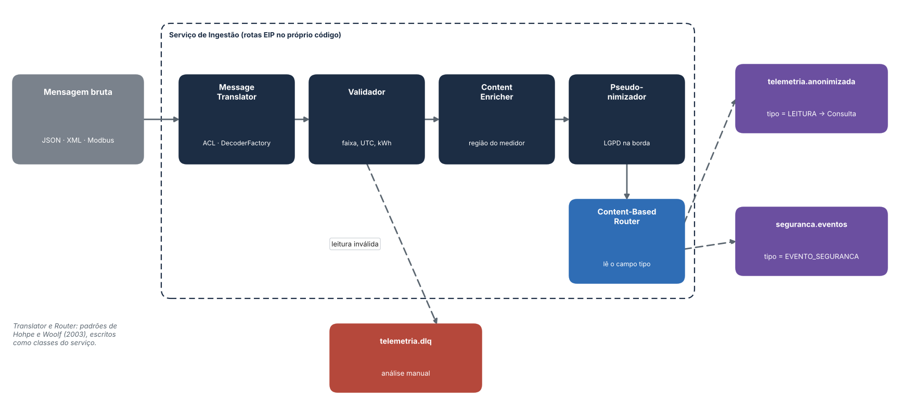

# ADR-011: AWS API Gateway na borda e padrões EIP implementados no código do Serviço de Ingestão, sem framework de integração nem *Service Mesh*

| Status | Data | Responsável |
|---|---|---|
| Aceito | 2026-11-11 | Caio (Líder da Sprint 3) |

## Contexto

Com os contextos delimitados (ADR 010) e os protocolos definidos (ADR 009), faltava decidir quem recebe o tráfego externo e onde ficam as regras de roteamento e tradução. Sem uma porta de entrada única, cada serviço reimplementaria autenticação, cotas e TLS. Sem um padrão para a ingestão, cada novo tipo de mensagem viraria um if a mais espalhado pelo código.

## Decisão

Usar o AWS API Gateway como porta de entrada do tráfego norte-sul (SCADA e *dashboard*), com autorizador JWT do Amazon Cognito, cotas por distribuidora e rotas por caminho. Implementar o *Message Translator*, o *Content Enricher* e o *Content-Based Router* como classes do Serviço de Ingestão, usando o cliente Kafka do próprio serviço (fluxo EIP abaixo). O tráfego leste-oeste continua só pelo Kafka (ADR 009), sem *Service Mesh*.

## Alternativas rejeitadas

(1) Kong autogerenciado: portável e sem dependência de nuvem, mas é mais um componente para a equipe manter com 99,99% de disponibilidade. (2) Apache Camel ou Spring Integration: oferecem rotas EIP prontas, mas trariam a JVM para um serviço em Python para resolver apenas três rotas. (3) ESB central: concentra regra de negócio no barramento e cria um ponto único de falha, o oposto da ADR 005. (4) Kafka Streams como roteador separado: escala bem, mas acrescenta um serviço para operar. (5) *Service Mesh* (Istio ou Linkerd): o mTLS e os *retries* automáticos só ajudam chamadas síncronas entre serviços, e a ADR 009 proíbe essas chamadas.

## Consequências positivas

Autenticação, cotas e TLS em um só lugar; os serviços recebem a requisição já validada. O gateway é gerenciado, sem servidor para a equipe manter. As regras de roteamento ficam no repositório do serviço e são testadas como qualquer classe. A arquitetura não ganha componentes novos além do gateway.

## Consequências negativas

Dependência da AWS: gateway e Cognito juntos tornam cara uma troca de nuvem. O acordo de nível de serviço publicado para o API Gateway é de 99,95% ao mês por região, abaixo da meta de 99,99%, o que obriga a implantar em duas regiões com *failover* por DNS. Custo cobrado por requisição e um salto de rede a mais em cada chamada do *dashboard*. O roteamento no código exige um *deploy* da Ingestão para cada tipo novo de mensagem. Sem *Service Mesh*, o rastreamento distribuído depende do identificador de correlação da ADR 009.

## Governança

Rotas, autorizadores e cotas do gateway versionados como código de infraestrutura e revisados em *pull request*. Alarme quando uma distribuidora atingir 80% da cota. Teste unitário para cada regra do roteador, cobrindo os tipos conhecidos e o envio de tipo desconhecido para a DLQ. Revisar a decisão sobre o *Service Mesh* se algum dia surgir chamada síncrona entre serviços. Teste periódico do *failover* entre regiões.

Fonte do SLA: [Amazon API Gateway SLA](https://aws.amazon.com/api-gateway/sla/)

