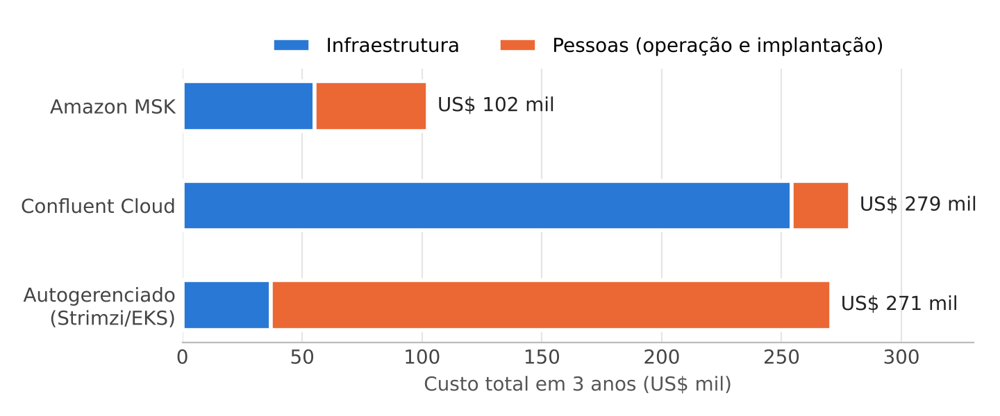

# ADR-012: Adoção do Amazon MSK Provisioned em sa-east-1, com réplica passiva em us-east-1 pelo MSK Replicator, como modelo de operação do Apache Kafka

| Status | Data | Responsável |
|---|---|---|
| Aceito | 2026-11-18 | Wilton (Líder da Sprint 4) |

## Contexto

O Kafka é o barramento por onde passa todo o tráfego entre os serviços (ADRs 001, 005 e 009), mas nenhuma decisão anterior definiu quem o opera. A própria ADR 001 registrou, entre suas consequências, a complexidade de gerir o *cluster* do *broker*. A carga é pequena para o Kafka, 2.111 mensagens por segundo, cerca de 118 KB/s e 312 GB por mês, mas a exigência é alta: o barramento herda a meta de 99,99% de todo o sistema, transporta dados de consumo protegidos pela LGPD e precisa de Schema Registry para o contrato telemetria.proto. Como o projeto já roda na AWS (ADR 011) e a AWS tem uma única região no Brasil, a meta de disponibilidade obriga a manter uma réplica fora do país. Três modelos atendem ao protocolo: Kafka gerenciado pela AWS, Kafka gerenciado pela Confluent e Kafka operado pela própria equipe.

## Decisão

Adotamos o Amazon MSK Provisioned com três *brokers* kafka.m7g.large distribuídos em três zonas de disponibilidade de sa-east-1, em São Paulo, como *cluster* principal. Mantemos um *cluster* passivo do mesmo porte em us-east-1, alimentado pelo MSK Replicator, para assumir em caso de perda da região principal. Usamos o AWS Glue Schema Registry para o contrato telemetria.proto, autenticação pelo IAM e criptografia pelo KMS, com retenção de 7 dias nos tópicos.

## Alternativas rejeitadas

A escolha foi feita por uma matriz ponderada de seis critérios, com pesos derivados dos drivers e notas de 1 a 10 (matriz abaixo):

| Critério | Peso | Amazon MSK | Confluent Cloud | Autogerenciado (Strimzi/EKS) |
|---|---|---|---|---|
| Disponibilidade garantida | 5 | 7 (35) | 9 (45) | 5 (25) |
| TCO em 3 anos | 5 | 10 (50) | 4 (20) | 4 (20) |
| Esforço operacional | 4 | 8 (32) | 9 (36) | 3 (12) |
| Segurança e LGPD | 4 | 9 (36) | 7 (28) | 7 (28) |
| Portabilidade | 3 | 5 (15) | 7 (21) | 9 (27) |
| Schema Registry e ecossistema | 3 | 6 (18) | 10 (30) | 7 (21) |
| **Total (máximo 240)** | | **186** | **180** | **133** |

(1) **Confluent Cloud (Enterprise, 2 eCKU):** é a escolha óbvia para quem olha só a técnica. Tem o único SLA de 99,99% em contrato, o Schema Registry de referência do ecossistema e o menor esforço de operação. Foi rejeitado pelo custo: US$ 278.575 em três anos, 2,7 vezes o MSK, quase todo formado pelo piso das eCKU exigidas para o SLA, que a nossa carga não chega a usar. O SLA superior também pode ser compensado com a réplica entre regiões, enquanto a diferença de custo não pode. O plano também acrescenta um segundo operador de dados pessoais ao projeto. (2) **Kafka autogerenciado no EKS com Strimzi:** tem a menor fatura de infraestrutura e a maior portabilidade, mas o custo real está nas pessoas. Uma pessoa dedicada responde por 86% do custo mensal, e o total em três anos (US$ 270.708) fica próximo ao do Confluent, sem nenhum SLA. É o Martelo de Maslow: flexibilidade que o problema não pede, paga em plantão. (3) **MSK Serverless:** disponível em São Paulo desde novembro de 2025, foi descartado antes da matriz porque cobra por partição e por GB em vez de por *broker*, o que dificulta prever o custo, e porque o MSK Provisioned já atende à carga no menor porte. A análise de sensibilidade mostra que, com o peso do TCO reduzido para 3, o Confluent Cloud passaria à frente. Mantivemos o peso 5 porque o custo do barramento entra no preço de cada contrato com as distribuidoras.

## Consequências positivas

Menor TCO entre os candidatos, cerca de US$ 102 mil (R$ 569 mil) em três anos, com previsibilidade: o custo é dominado por *brokers* de preço fixo por hora, e não por tráfego. O barramento fica na mesma conta, rede privada e modelo de permissões (IAM) do restante do sistema, sem novo fornecedor para auditar na LGPD. A AWS substitui *brokers* com falha e aplica *patches*, e a equipe dedica cerca de 0,2 pessoa à operação, contra uma pessoa inteira no modelo autogerenciado. O Glue Schema Registry não tem custo adicional e suporta Protobuf. Os serviços continuam falando o protocolo Kafka padrão, então o código das ADRs 003 e 009 não muda.

## Consequências negativas

O SLA do MSK garante apenas 99,9% por região, abaixo da meta de 99,99%; a meta passa a depender da réplica em us-east-1 e de um *failover* bem ensaiado, que é responsabilidade da equipe e não do fornecedor. A segunda região quase dobra o custo de infraestrutura: a réplica e a replicação somam cerca de metade dos US$ 1.529 mensais. A réplica fora do Brasil é uma transferência internacional de dados pseudonimizados, que precisa de base legal e de cláusulas contratuais pela LGPD. A transferência a partir de São Paulo custa US$ 0,138 por GB, uma das tarifas mais altas da AWS. O *lock-in* com a AWS aumenta: IAM, Glue Schema Registry e MSK Replicator não existem fora dela, e uma troca de nuvem exigiria refazer autenticação, registro de esquemas e replicação. A integração do Glue Schema Registry é mais madura em Java do que em Python. A equipe ainda responde pelo dimensionamento, pelo rebalanceamento de partições e pelas atualizações de versão. Os preços do MSK em São Paulo foram estimados a partir de us-east-1 com fator regional de 1,59 e precisam ser confirmados na calculadora oficial da AWS antes da contratação.

## Governança

Teste de *failover* para us-east-1 a cada trimestre, medindo o tempo de troca, com meta de até 4 minutos por mês de indisponibilidade somada (o orçamento de 99,99%). Alarmes para atraso do MSK Replicator acima de 60 segundos, uso de disco acima de 70% e qualquer *broker* fora do ar. Orçamento mensal na AWS com alerta em 120% do custo estimado de infraestrutura (US$ 1.835). Revisão desta ADR em três situações: disponibilidade geral da região AWS do Chile com MSK, o que aproximaria a réplica e reduziria o risco de LGPD; volume escrito acima de 10 vezes o atual; ou SLA do MSK elevado a 99,99%. Toda mudança de esquema continua passando pela regra de compatibilidade retroativa da ADR 009, agora aplicada no Glue Schema Registry. Configuração do *cluster*, tópicos e permissões versionada como código de infraestrutura e revisada em *pull request*.

Fontes: [Amazon MSK SLA](https://aws.amazon.com/msk/sla) · [Confluent Cloud SLA por tipo de *cluster*](https://docs.confluent.io/cloud/current/clusters/cluster-types.html) · [MSK Serverless em São Paulo](https://aws.amazon.com/about-aws/whats-new/2025/11/amazon-msk-serverless-south-america-sao-paulo-region) · [Região AWS do Chile para clientes selecionados](https://www.aboutamazon.com/news/aws/aws-south-america-chile-region-launch)

