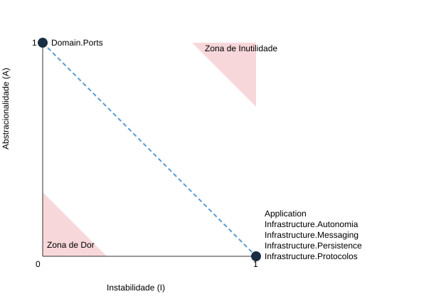

# Relatório automatizado de métricas de acoplamento

Gerado por `fitness/metricas.py` a partir do código em `src/`. Não edite à mão: o CI regera este arquivo a cada *pull request*.

| Pacote | Nc | Na | A | Ca | Ce | I | D |
|---|---|---|---|---|---|---|---|
| Domain.Ports | 19 | 19 | 1.00 | 33 | 0 | 0.00 | **0.00** |
| Application | 18 | 0 | 0.00 | 0 | 16 | 1.00 | **0.00** |
| Infrastructure.Autonomia | 6 | 0 | 0.00 | 0 | 6 | 1.00 | **0.00** |
| Infrastructure.Messaging | 2 | 0 | 0.00 | 0 | 2 | 1.00 | **0.00** |
| Infrastructure.Persistence | 2 | 0 | 0.00 | 0 | 2 | 1.00 | **0.00** |
| Infrastructure.Protocolos | 7 | 0 | 0.00 | 0 | 7 | 1.00 | **0.00** |

## Regras de arquitetura

| Regra | Resultado |
|---|---|
| R1. Domain.Ports não referencia Application nem Infrastructure | Aprovada |
| R2. Application não referencia Infrastructure | Aprovada |
| R3. Bibliotecas de fornecedor só na Infrastructure | Aprovada |
| R4. Toda classe de Infrastructure implementa uma abstração de Domain.Ports | Aprovada |
| R5. Domain.Ports só contém abstrações (A = 1) | Aprovada |
| R6. Todo pacote com D <= 0.1 | Aprovada |
